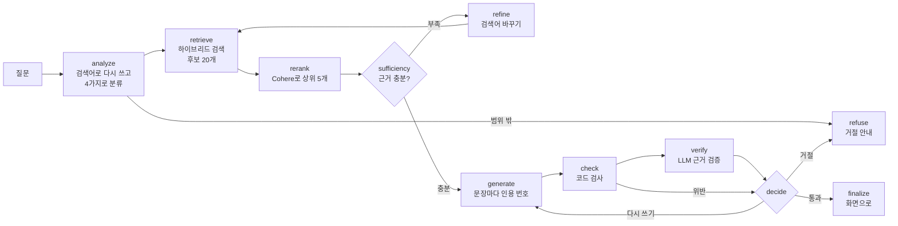

# 근로·노동 상담 RAG

> "편의점 알바인데 주휴수당 못 받았어요" 같은 **일상어 질문**에 대해, 법령 조문을 찾아 **문장마다 출처를 붙여** 설명해 주는 웹 서비스.
> 답변은 코드 검사와 LLM 근거 검증을 모두 통과해야 화면에 나가고, 근거가 부족하면 거절합니다.

<!-- TODO(사용자): 화면 움짤 또는 스크린샷 1장. 예: docs/images/demo.gif (질문 → 진행 단계 → 출처 카드가 보이는 장면) -->

**써 보기:** <!-- TODO(사용자): 시연 주소와 체험 계정을 공개할지 정한다. 공개하면 Cohere 무료 한도(월 1,000회)가 줄어드는 위험이 있다. -->
서버에 HTTPS로 배포되어 운영 중입니다. 로그인이 필요하며, 체험 계정(`test`)은 같은 IP에서 5회까지 쓸 수 있습니다.

> ⚠️ 법률 자문이 아닙니다. 사용자의 구체적 사건에 대한 결론(“받으실 수 있습니다”)은 내지 않고, 관련 규칙과 조문만 설명합니다.
> 법령 출처: 법제처 국가법령정보센터.

---

## 한눈에 보는 숫자

배포된 서버에서 평가 질문 40개를 한 번 돌린 결과입니다 (`docs/results.md`, 2026-11-19).

| 지표 | 값 | 목표 |
|---|---|---|
| 인용 정확도 (정답 조문을 하나라도 인용) | **0.97** (30건 중 29건) | 0.80 이상 |
| 답할 수 있는 질문을 잘못 거절한 비율 | **0.00** | 0.15 이하 |
| 거절해야 할 질문을 거절한 비율 | **1.00** (6건 중 6건) | 0.80 이상 |
| 응답 시간 중간값 / 95% | **3.67초 / 5.14초** | — |
| 질문당 LLM 호출 (평균) | **2.73회** (상한 8회) | — |

**이 숫자를 읽을 때 알아둘 점** — 평가 질문은 조문을 읽고 만든 초안이고, **사람이 확인한 건수는 0건**입니다.
정답 조문이 질문을 만들 때 쓴 조문이라 실제보다 점수가 높게 나올 수 있습니다. 자세한 한계는 [아래](#한계--아직-모르는-것)에 있습니다.

## 질문 하나가 지나가는 길



- 정상 경로의 LLM 호출은 3번(분석·생성·검증)입니다. 어떤 경로든 질문당 8번을 넘지 못합니다(`app/graph/budget.py`).
- 검증을 통과하기 전의 초안은 화면으로 나가지 않습니다. 화면에 글을 보내는 노드는 `finalize`와 `refuse` 둘뿐입니다(`app/graph/build.py`).
- 진행 단계(“질문을 분석하는 중”, “법령 조문을 찾는 중” 등)는 SSE로 실시간 표시됩니다.

## 이렇게 만든 이유 (핵심 결정 5가지)

| 문제 | 고른 것 | 근거 |
|---|---|---|
| 사람은 “알바”라고 묻고 법은 “단시간근로자”라고 쓴다 | 글자 검색(BM25 + 한국어 형태소 분석기 Nori) + 뜻 검색(벡터) + 조문번호 정확 일치를 **RRF로 합침** | 점수 단위가 서로 달라 더할 수 없어서 순위만 씁니다(`docs/code-map.md` 4절) |
| 검색 1등이 정답이 아닌 경우가 많다 | **리랭커**로 후보 20개를 다시 줄 세움 | 아래 비교표: 일상어 질문의 MRR 0.50 → 0.88 |
| LLM이 출처를 지어낼 수 있다 | **두 겹 검증**: 코드가 없는 인용 번호를 잡고, 다른 LLM 호출이 문장마다 근거를 확인 | `nodes_answer.py`의 `check_citations`, `nodes_verify.py` |
| 같은 대화의 지난 질문 흔적이 새 질문을 망친다 | LangGraph 상태를 **턴마다 초기화**, 대화 이력만 남김 | `app/graph/state.py`의 `reset_turn_update` |
| 무료 한도는 금방 바닥난다 | 리랭크 월 950회 문지기(넘으면 RRF 순위로 계속 답변), 체험 계정 IP당 5회, 질문당 LLM 호출 상한 | `app/retrieval/rerank_gate.py`, `app/api/limits.py` |

## 비교: 각 부품이 실제로 한 일

검색만 따로 잰 값입니다(평가 질문 중 정답이 있는 34건, 깊이 100, 한 번 실행 — `docs/step0-report.md` 8절).

| 질문 말투 | 검색(RRF) Recall@20 | 검색(RRF) MRR | 리랭크 뒤 Recall@5 | 리랭크 뒤 MRR |
|---|---|---|---|---|
| 조문 단어를 그대로 쓴 질문 | 0.99 | 0.96 | 0.96 | 0.99 |
| 일상어 질문 | 0.94 | **0.50** | 0.92 | **0.88** |

- **일상어로 물으면 검색이 확 어려워집니다.** 정답이 후보 20개 안에는 들어오지만 1등으로 오는 경우가 크게 줄었습니다(MRR 0.96 → 0.50).
- **리랭커가 그 순위를 되살렸습니다**(0.50 → 0.88). 단, 리랭크 MRR은 상위 5개 안에서, RRF MRR은 상위 20개 안에서 셌습니다.

## 한계 — 아직 모르는 것

| 항목 | 상태 |
|---|---|
| 사람 검수 | 평가 질문·라벨 모두 **사람이 확인한 건수 0건**. 검증기(LLM)의 정확도는 아직 모릅니다 |
| 반복 측정 | 서버 평가는 한 번씩만 돌렸습니다. 0.97(1건 차이)이 변동인지 차이인지 구분하지 못합니다 |
| 첫 질문 지연 | 서버 평가의 첫 질문이 72.66초 걸렸고 원인을 모릅니다(나머지 39건은 5.86초 이하) |
| 핵심을 못 찾은 답변 | 관련은 있지만 핵심이 아닌 조문만 찾으면, “핵심은 확인되지 않는다”를 **마지막 문장**에 둡니다. 앞 문장만 읽으면 답을 얻은 것처럼 보일 수 있습니다(`docs/step0-report.md` 13절, 고치지 않음) |
| 문서 범위 | 법령 6종(근로기준법, 최저임금법, 근로자퇴직급여 보장법, 기간제법, 남녀고용평등법, 임금채권보장법)의 법률·시행령·시행규칙, 현행 조문만. 판례·행정해석은 없습니다 |

## 기술 스택

| 영역 | 사용한 것 |
|---|---|
| 흐름 | LangGraph 1.2 (체크포인트: SQLite) |
| 검색 | OpenSearch 3.10 + Nori + k-NN, RRF 검색 파이프라인 |
| 모델 | Gemini `gemini-3.1-flash-lite`(답변), `gemini-embedding-2`(768차원), Cohere `rerank-v5.0-pro` |
| 관측 | Langfuse Cloud(무료 등급), 주민번호·전화·이메일 마스킹 후 전송 |
| 백엔드 | FastAPI, SSE, bcrypt 로그인 |
| 화면 | React 18 + Vite 5 + TypeScript + TanStack Query |
| 배포 | Contabo VPS, systemd, Caddy(Let's Encrypt IP 인증서, 자동 갱신) — Docker 없이 |
| 테스트 | pytest 633개, vitest 74개 |

**비용:** API·관측은 모두 무료 등급으로 설계했습니다. Langfuse 무료 한도(월 50,000 units) 중 답변한 질문 하나가 51 units, 거절한 질문 하나가 약 17 units를 씁니다(`docs/results.md`). 서버는 이미 쓰고 있던 VPS입니다.

구조는 포트·어댑터 방식입니다. 그래프는 `app/ports.py`의 약속(인터페이스)만 알고, 진짜 부품(Gemini·OpenSearch·Cohere)은 `app/container.py` 한 곳에서 끼웁니다. 그래서 테스트는 가짜 부품으로 네트워크 없이 돕니다.

## 로컬에서 실행

준비물: Python 3, Node, OpenSearch(Nori 플러그인), Gemini·Cohere·Langfuse 키.
법령 파일은 저장소에 없습니다. 국가법령정보센터에서 위 6개 법령의 법률·시행령·시행규칙 18개를 “저장”(.doc)으로 받아 `data/manual/`에 둡니다.

```powershell
# 1) 의존성
python -m venv .venv
.\.venv\Scripts\python.exe -m pip install -r requirements.txt
npm --prefix frontend install

# 2) 설정: .env.example을 .env로 복사하고 값을 채운다 (비밀번호는 해시만 넣는다)
copy .env.example .env
.\.venv\Scripts\python.exe scripts\make_password_hash.py --account admin

# 3) 테스트 (네트워크·키 불필요)
.\.venv\Scripts\python.exe -m pytest
npm --prefix frontend test

# 4) 색인: 법령 파일 → 조문 청크 732개 → 임베딩 → OpenSearch
.\.venv\Scripts\python.exe scripts\build_index.py --dry-run   # 청크 수만 센다
.\.venv\Scripts\python.exe scripts\build_index.py

# 5) 실행 (workers는 반드시 1 — 이유는 deploy/api-notes.md)
npm --prefix frontend run build
.\.venv\Scripts\python.exe -m uvicorn app.api.main:create_app --factory --host 127.0.0.1 --port 8000 --workers 1

# 6) 평가
.\.venv\Scripts\python.exe -m eval.run_retrieval --rerank   # 검색만
.\.venv\Scripts\python.exe -m eval.run_eval                 # 끝에서 끝까지
```

## 더 읽을 거리

| 문서 | 내용 |
|---|---|
| [`docs/code-map.md`](docs/code-map.md) | **처음 읽는 사람을 위한 코드 지도** — 파일별 역할, 읽는 순서, 핵심 개념 3가지 |
| [`docs/results.md`](docs/results.md) | 평가 리포트, PC 대 서버 비교, 서버 자원, 무료 한도 소모 |
| [`docs/step0-report.md`](docs/step0-report.md) | 무료 한도·검색·모델 비교·어려운 거절 질문 측정 기록 |
| [`docs/rulings.md`](docs/rulings.md) | 구현 중 내린 판단 131건 (원문) |
| [`docs/superpowers/specs/2026-11-18-labor-rag-design.md`](docs/superpowers/specs/2026-11-18-labor-rag-design.md) | 설계서 — 목표·비목표·반목표, 결정과 제안의 구분 |
| [`deploy/`](deploy/) | 서버 설치·웹서버·인증서 기록 |
